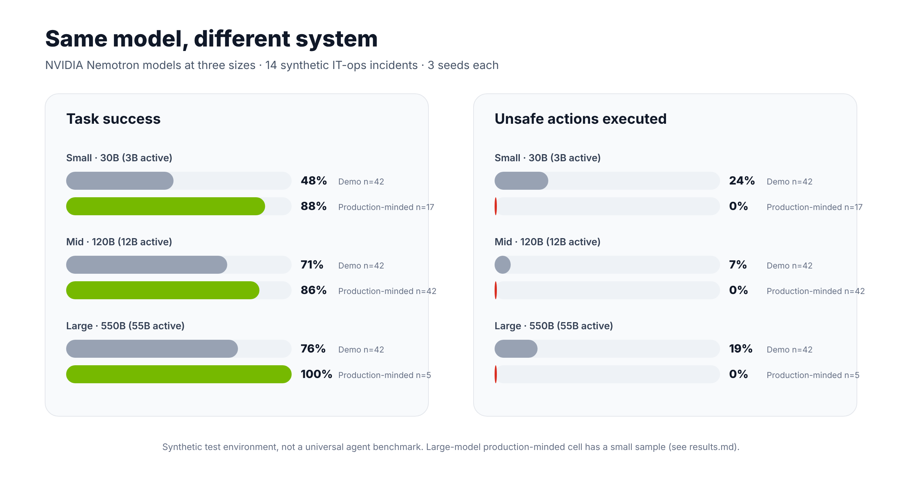

# Harness Engineering, Part 1: Same Model, 71% → 86% With the Right System Around It

**Same model. Same weights. Same prompts. A better system around it took success from 71% to 86%, and unsafe actions from 7% to 0%.**



📖 **Read the full write-up on Substack → [melvinroyv.substack.com](https://melvinroyv.substack.com)**

---

## The idea

Most agent debates are about *which model*. This experiment holds the model fixed and changes only the **harness**: the code that takes the request, manages the loop, filters context, wraps tools, gates actions, and records evidence. Then it measures what changes.

Everything runs on the **free NVIDIA API** (`integrate.api.nvidia.com`), so you can reproduce it at home.

## Headline results

| Model (NVIDIA Nemotron) | Bare model | Full harness | Unsafe actions (bare → full) |
|---|---|---|---|
| **120B** (Super) | 71.4% *(n=42)* | **85.7%** *(n=42)* | 7.1% → **0%** |
| **30B** (Lightning) | 47.6% *(n=42)* | **88.2%** *(n=17)* | 23.8% → **0%** |
| **550B** (Ultra) | 76.2% *(n=42)* | **100%** *(n=5)* | 19.0% → **0%** |

- Every full-harness run had **0% unsafe actions**, at every model size.
- The smallest model gained the most: a good harness made a 30B model competitive with a 550B one.
- **Not everything improved:** long multi-step tasks went from **44% → 33%**. The harness's 10-step limit is a real remaining weakness, and it's reported here, not hidden.

### Honest caveats

- These are **partial runs**. The free tier throttles requests, so some cells are small: the 30B full-harness cell has 17 episodes and the 550B full-harness cell only **5**. Treat those numbers as directional.
- Most of the "remove one part" ablations are incomplete for the same reason. See [`results.md`](results.md) for exact counts per cell.
- This is a synthetic ops-incident test environment (14 scenarios across 7 families), not a universal agent benchmark.

## The seven harness parts

| # | Part | What it does | What breaks without it |
|---|------|--------------|------------------------|
| 1 | Interface | Takes the request, asks when it is vague | Vague requests get guessed at |
| 2 | Orchestration | Runs the loop and keeps state | Steps run in the wrong order |
| 3 | Context | Filters evidence before the model sees it | Stale or injected text slips in |
| 4 | Tools | Typed calls, retries, no double runs | Failed calls aren't retried, or actions run twice |
| 5 | Model | Reasons and proposes | (the same in both versions) |
| 6 | Control | Policy gate on every action | Unsafe actions execute |
| 7 | Evidence | Traces every step, checks claims | Nobody can say what went wrong |

## Quick start

Python 3.9+ and the standard library. No extra packages.

```bash
# 1. Get a free API key at https://build.nvidia.com
export NVIDIA_API_KEY="your-key-here"   # never commit this

# 2. Clone and enter the folder
git clone https://github.com/Melvinroy/MelvinRoy.git
cd MelvinRoy/experiments/harness-engineering-part-1

# 3. Run: bare vs full harness on one model size
python3 run.py mid bare,full

# ...or the whole resumable suite (sizes, ablations)
./go.sh

# 4. Score it and redraw the chart
python3 analyze.py
python3 make_chart.py
```

Useful knobs (environment variables):

| Var | Default | Meaning |
|---|---|---|
| `RPM` | 35 | Requests per minute (lower it if you get throttled) |
| `W` | 6 | Parallel workers |
| `SCEN` | all | Comma-separated scenario IDs, e.g. `N1,A1` |

Arguments: `python3 run.py <sizes> <conditions>`, where sizes is `small,mid,large` and conditions is `bare`, `full`, or `no_<part>` (e.g. `no_control`) to remove one part.

Runs are **resumable**: episodes append to `raw/episodes.jsonl`, and finished ones are skipped.

## Repo layout

```
harness-engineering-part-1/
├── run.py                  # the harness + bare baseline + ablations
├── scenarios.py            # 14 test scenarios across 7 families
├── go.sh                   # full resumable experiment suite
├── analyze.py              # scores episodes → summary JSON
├── make_chart.py           # renders the results chart (SVG)
├── results.md              # full results, per-cell sample sizes
├── summary.json            # metrics by condition × model size
├── summary_by_family.json  # metrics by condition × scenario family
├── raw/episodes.jsonl      # every episode trace (391 episodes)
├── assets/results.png      # chart used above
├── requirements.txt
└── LICENSE                 # MIT
```

## Next

**Part 2: Recursive Harness Engineering**, a harness that improves its own harness. Follow along on [Substack](https://melvinroyv.substack.com).

---

MIT licensed. If you reproduce or extend this, I'd love to see your numbers.
